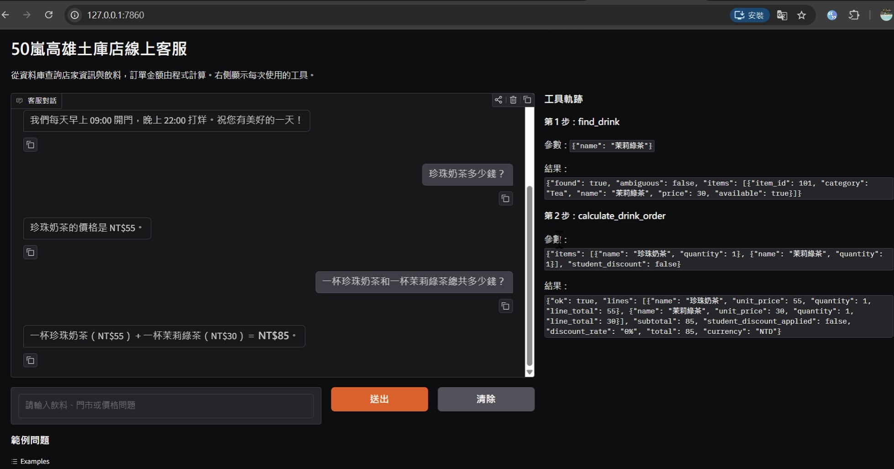
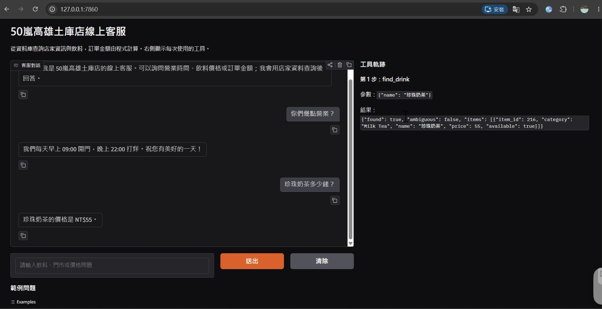
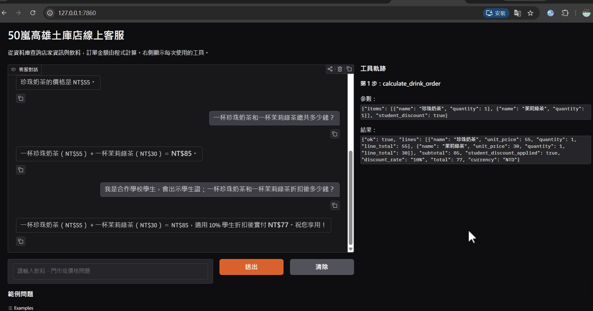
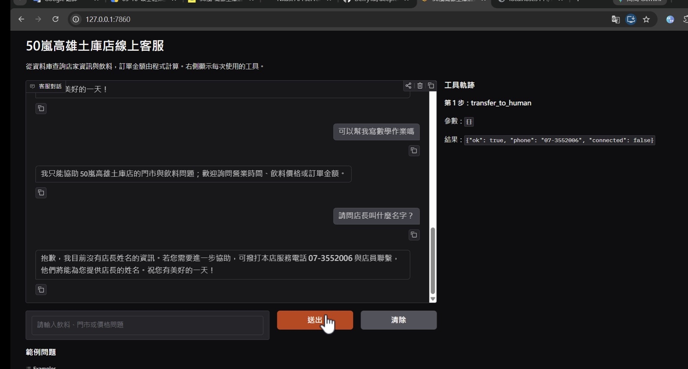
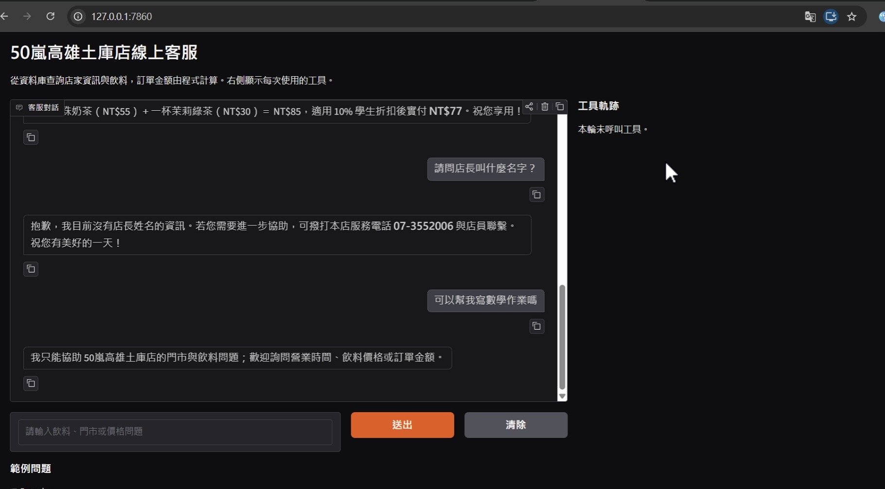

# 50嵐高雄土庫店 Customer Service Agent

This Gradio chat assistant helps customers ask about the Kaohsiung Tuku store, look up drink prices and availability, and calculate order totals. Store answers come from SQLite tables rebuilt from the two supplied CSV files whenever the app starts. The model selects tools; the tools retrieve facts or calculate amounts.

> Course homework: Unit G, My AI Customer Service Agent, with a Database and Tools  
> Student: F115118116 戴琨達



## Who It Serves and When They Use It

- **Who uses it:** Customers considering a drink purchase at the Kaohsiung Tuku store.
- **When they use it:** When they want quick answers about store information, drink prices, availability, or the cost of several drinks.
- **What problem it solves:** It combines store facts and an 82-drink menu in one conversation and shows the source tool used for every factual answer.

## What It Can Do

| Function | Example question | Tool |
|---|---|---|
| Look up store information | 「你們幾點營業？」 | `get_store_info` |
| Find a drink and price | 「珍珠奶茶多少錢？」 | `find_drink` |
| Calculate an order | 「一杯珍珠奶茶和一杯茉莉綠茶總共多少錢？」 | `calculate_drink_order` |
| Provide a staff phone number | 「我要找店員。」 | `transfer_to_human` |

Student discount is applied only when the customer states that they qualify and will present a partner-school student ID. It reduces the order total by 10%, with the final amount rounded to the nearest whole New Taiwan dollar (half up). Delivery availability for this branch is **unconfirmed**; the assistant refers those questions to store staff.

## How It Works

Every question goes to the agent first. The agent selects an allowed tool, which reads the database or calculates in Python. The right-hand panel shows tool names, arguments, and results. Conversation history is sent with later questions. The agent loop allows at most six model calls and rejects unknown tools.

- **Model:** `Furen-large` through the user-configured NKUST OpenAI-compatible endpoint.
- **Chat screen:** Gradio.
- **Database:** SQLite, rebuilt at startup from CSV.

| Table | CSV file | Columns | Rows |
|---|---|---|---:|
| `shop_info` | `my_shop_info.csv` | `topic`, `content` | 8 |
| `drinks` | `my_menu.csv` | `item_id`, `category`, `name`, `price`, `available` | 82 |

## Sample Conversations

The following outcomes were recorded in the live 12-question test. The Gradio screen shows each answer beside its tool trace.

| Customer asks | Recorded answer or outcome | Tool trace |
|---|---|---|
| 「珍珠奶茶多少錢？」 | NT$55 | `find_drink` |
| 「一杯珍珠奶茶和一杯茉莉綠茶總共多少錢？」 | NT$85 | `find_drink`, `calculate_drink_order` |
| 「請問店長叫什麼名字？」 | The information is unavailable; call 07-3552006. | `transfer_to_human` |
| 「可以幫我寫數學作業嗎？」 | Politely declines an unrelated request. | No tool call |









## Project Files

```text
app.py                 Gradio chat screen and visible tool trace
agent_core.py          CSV import, SQLite tools, prompt, agent loop
my_shop_info.csv       Store information
my_menu.csv            Drink records
tool_choice_test.py    12-question live routing test
requirements.txt       Python dependencies
.env.example           Settings template without a key
.gitignore             Excludes the key and generated database
tests/                 Offline behavior tests
images/                Screenshots of the running app
```

The `.db` file is generated locally and is not part of the repository.

## How to Install and Run It

1. Use Python 3.10 or newer, then get this repository:

   ```bash
   git clone https://github.com/DerryTai/deeplearning_hw.git
   cd deeplearning_hw
   ```

2. Install dependencies:

   ```bash
   python -m pip install -r requirements.txt
   ```

3. Copy `.env.example` to `.env` and add your own `API_KEY`. Keep `.env` private. The endpoint and model must support tool calling.

   ```powershell
   Copy-Item .env.example .env
   ```

4. Start the chat app and open the local address printed in the terminal, normally <http://127.0.0.1:7860>:

   ```bash
   python app.py
   ```

5. Run the offline tests and, if you have API access, the 12-question live tool-choice test:

   ```bash
   python -m unittest discover -s tests -v
   python tool_choice_test.py --delay 10
   ```

## Notes

- Store details and prices are the CSV snapshot supplied for this assignment. Availability is the value in the CSV, not a live inventory feed.
- The assistant provides the store phone number for human help. It cannot connect a call inside the chat.
- The API key is loaded only from `.env` and is not included in this repository.
